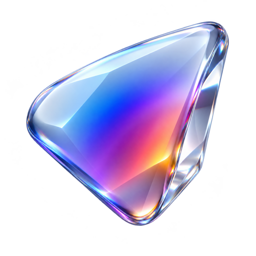
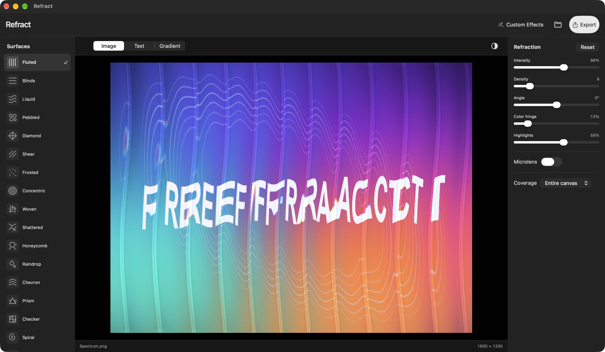

# Refract



Refract is a native macOS and iPadOS app for applying glass distortion to photos, graphics, and type. The editor runs locally and uses the same renderer for previews and exports.

[Download for Mac](../../releases/latest) · [What’s new in 4.1.0](docs/release-notes/4.1.0.md)



## Download

Download **Refract-4.1.0-macOS.zip** from [Releases](../../releases), unzip it, and move `Refract.app` to your Applications folder. It runs on Apple Silicon and Intel Macs with macOS 13 or later.

The release ZIP contains an ad hoc signed build. If Gatekeeper blocks the first launch, consult [Apple’s instructions for opening an unnotarized app](https://support.apple.com/en-us/102445).

## Using Refract

- **Image** opens files or accepts a drop on the canvas. On iPad, you can also pick from Photos. A PDF opens on its first page.
- **Text** starts with an empty canvas. Type your text and choose a face, ink, and background.
- **Gradient** stays blank until you select **New Gradient**. Set the colors and direction in Adjustments, or switch to a radial gradient. **Clear Gradient** returns to the empty canvas.
- **Surfaces** contains 18 glass patterns. Add Microlens for a finer texture or use Coverage to restrict the effect to one half.
- **Custom Effects** is the wand in the toolbar. Create an effect, choose two surfaces, and adjust how they blend. You can set density, angle, offset, stretch, refraction, and microlens settings. Give your effect a name and save it to reuse later. Saving under an existing name updates that preset.
- **Export** saves PNG, JPEG, or TIFF in sRGB. PNG and TIFF preserve transparency. JPEG uses a white background wherever the artwork is transparent. The print setting writes 300 DPI metadata.

The canvas supports pinch-to-zoom on iPad and Mac trackpads. When built with Xcode 27 or later, the Mac build also enables direct-touch pinch on macOS 27 or later. Use **Fit Artwork** to reset it. On smaller windows, Effects and Adjustments open from the toolbar.

## Build

Open `Refract.xcodeproj` in Xcode. The project uses only Apple frameworks.

**Mac** — Select the Refract scheme and **My Mac**, then press **⌘R**. Run the packaging script from the repository root to build a release for Apple Silicon and Intel.

```sh
./scripts/package-macos.sh
```

The app is at `build/Build/Products/Release/Refract.app`. The script verifies the signature and both architectures, then creates `build/Refract-4.1.0-macOS.zip` and its SHA-256 checksum.

To publish this update, create a GitHub release with tag `v4.1.0` on the commit containing the update. Attach the macOS ZIP and its `.sha256` file, and use the [4.1.0 release notes](docs/release-notes/4.1.0.md). For a notarized build, follow [Apple’s Developer ID signing and notarization instructions](https://developer.apple.com/documentation/security/notarizing-macos-software-before-distribution).

**iPad** — Select an iPad simulator or an iPad running iPadOS 17 or later, then press **⌘R**. For a physical iPad, choose your Team under **Signing & Capabilities**. If Xcode reports a bundle ID conflict, set a unique ID for your build. [Apple’s Developer Mode instructions](https://developer.apple.com/documentation/xcode/enabling-developer-mode-on-a-device) cover running on a physical device. Public iPad distribution requires a signed distribution build.

## Source

- `StudioView.swift` contains the adaptive editor, import flow, and export controls.
- `EffectWorkshop.swift` contains the custom effect editor.
- `StudioModel.swift` manages previews and local preset storage.
- `Rendering/GlassRenderer.swift` converts artwork to an sRGB bitmap and encodes the output.
- `Rendering/Glass.cpp` contains the individual surface displacement functions and pixel sampler.

A surface returns a sampling offset and a highlight value. Custom Effects blend the offsets from two surfaces before sampling the source. The microlens layer adds a smaller offset around each lens center.

## License

[MIT](LICENSE)
